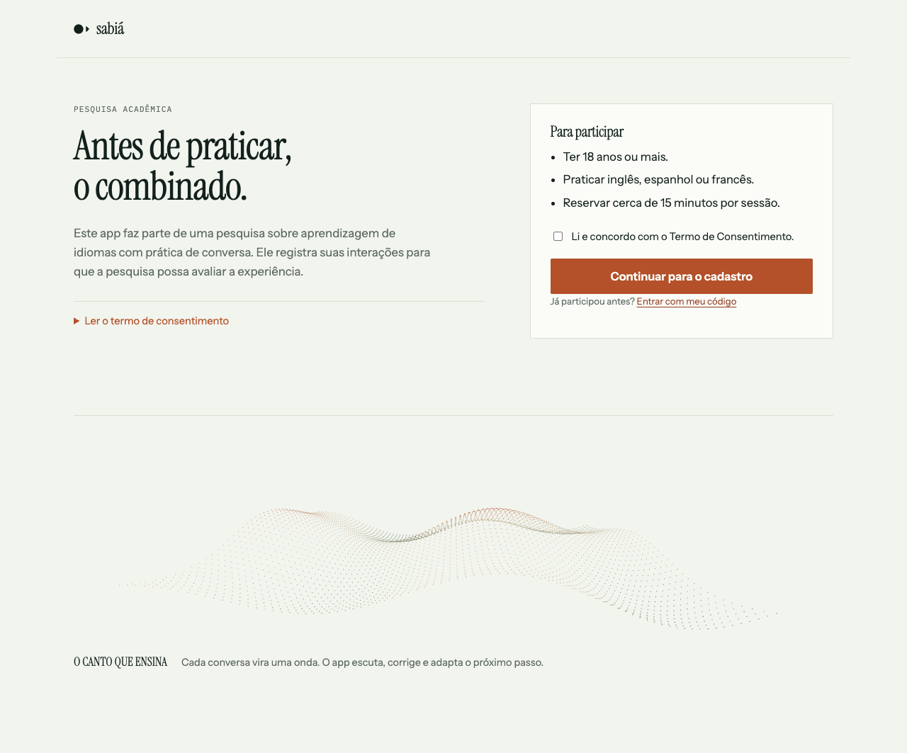
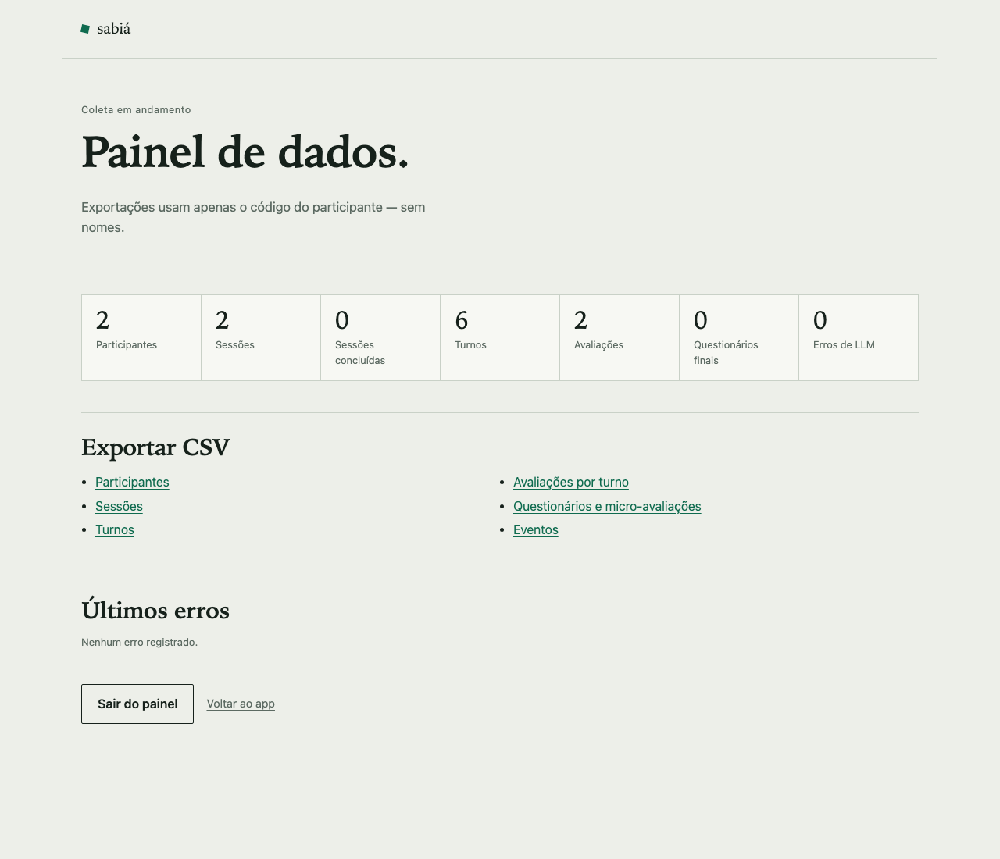
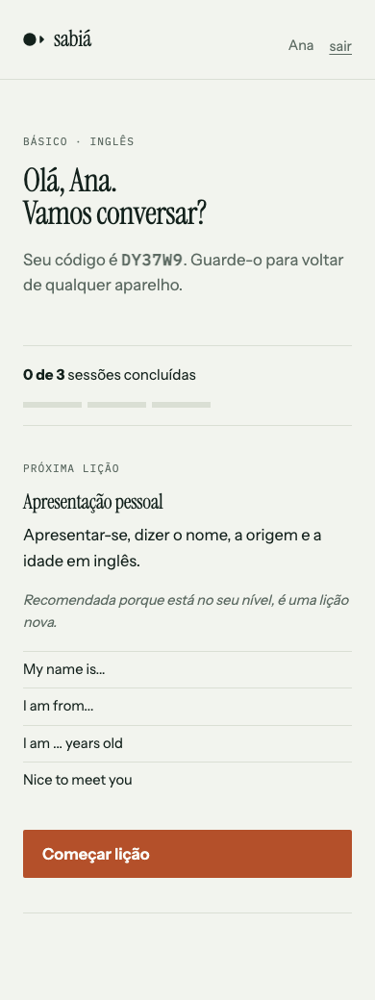
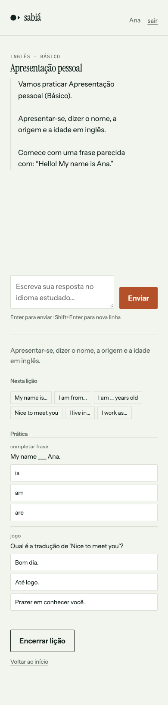

# Sabiá — app de prática de idiomas

App web multiusuário para praticar inglês, espanhol e francês em conversas curtas,
com personalização e coleta de dados para o TCC.

**Status:** MVP funcional com LLM real (Gemini) validado, painel de dados, questionário
final, segurança baseline, prática corrigida e QA local (4/5); **30 testes passando**.
Identidade v0.2 aplicada: símbolo Bico, Instrument Serif/Sans, paleta papel/noite/canto
e a faixa 3D em Three.js local.

**Revisão das 60 lições:** [relatório](docs/revisao-licoes.md) ·
[agentes](agents/README.md) · [design](docs/design.md).

**As 60 lições para revisão:** [XLSX](docs/licoes-60.xlsx) ·
[Markdown](docs/licoes-60.md) · [JSON](docs/licoes-60.json).
QA: [relatório](docs/qa-relatorio.md) · Design: [identidade e UX](docs/design.md) ·
Deploy: [DEPLOY.md](DEPLOY.md).



## Rodar localmente (sem chave de API)

```bash
cd .
uv venv .venv --python 3.12
uv pip install --python .venv/bin/python -r requirements.txt
LLM_PROVIDER=mock .venv/bin/python -m uvicorn app.main:app --port 8000
```

Abra <http://127.0.0.1:8000>. O modo `mock` responde de forma determinística — serve
para navegar, testar o fluxo e desenvolver sem gastar tokens.

## Rodar com Gemini

```bash
export LLM_PROVIDER=openai
export LLM_API_KEY="sua-chave"
export LLM_MODEL="gemini-2.5-flash"
.venv/bin/python -m uvicorn app.main:app --port 8000
```

A URL padrão já aponta para o endpoint compatível com OpenAI do Google
(`https://generativelanguage.googleapis.com/v1beta/openai`). Para outro provedor
(OpenAI, Gemini, Groq, OpenRouter, Ollama), ajuste `LLM_BASE_URL` e `LLM_MODEL`.

Ou use um `.env` (o app carrega automaticamente):

```bash
cp .env.example .env
# edite LLM_PROVIDER, LLM_BASE_URL, LLM_API_KEY e LLM_MODEL
.venv/bin/python -m uvicorn app.main:app --port 8000
```

## Testar o LLM real

Antes do piloto, rode o teste de fumaça com o mesmo prompt de um turno:

```bash
LLM_PROVIDER=openai \
LLM_BASE_URL=https://api.openai.com/v1 \
LLM_API_KEY="sua-chave" \
LLM_MODEL="seu-modelo" \
.venv/bin/python scripts/check_llm.py
```

Ele mostra latência, tokens, se o JSON veio válido e a correção sugerida para um erro
proposital. Para Gemini, troque o `LLM_BASE_URL` pelo endpoint do Google.

## Piloto

Roteiro de 30–40 min com 3–5 pessoas, o que observar, registro de bugs e critérios de
sucesso em [`docs/piloto.md`](docs/piloto.md).

## Backup

Com Postgres em produção: `DATABASE_URL=... ./scripts/backup_db.sh` gera um `.sql.gz`
em `backups/`. Agende no cron ou em um job do provedor.

## Configuração

| Variável | Padrão | Função |
|---|---|---|
| `APP_SECRET` | dev | assina cookies; **troque em produção** |
| `DATABASE_URL` | `sqlite:///data/app.db` | SQLite local ou Postgres |
| `LLM_PROVIDER` | `mock` | `mock` ou `openai` |
| `LLM_BASE_URL` | Gemini (OpenAI-compat) | endpoint `/chat/completions` |
| `LLM_API_KEY` | vazio | chave do provedor |
| `LLM_MODEL` | `gemini-2.5-flash` | modelo usado |
| `LLM_FALLBACK_*` | vazio | segundo provedor em caso de falha |
| `ADMIN_PASSWORD` | vazio | habilita o painel `/admin` |
| `REQUIRED_SESSIONS` | `3` | sessões até o questionário final |
| `APP_COOKIE_SECURE` | `0` | `1` atrás de HTTPS |
| `RATE_LIMIT_ENABLED` | `1` | proteção contra abuso |

## Painel de dados

Defina `ADMIN_PASSWORD` e abra <http://127.0.0.1:8000/admin>. O painel mostra
contagens (participantes, sessões, turnos, avaliações, questionários, erros de LLM) e
exporta CSV de participantes, sessões, turnos, avaliações, questionários e eventos.
As exportações usam **apenas o código do participante**, sem nome ou sobrenome.



## Segurança

- CSRF double-submit em formulários e APIs JSON.
- Rate limit por IP em entrada, cadastro, turno, admin e questionário.
- Cookies assinados, `HttpOnly`, `SameSite` e `Secure` em produção.
- CSP restritiva, `X-Frame-Options: DENY`, `nosniff`, `Referrer-Policy`.
- Exportação pseudonimizada e acesso restrito por senha.

Detalhes, riscos residuais e checklist de deploy em
[`docs/seguranca.md`](docs/seguranca.md). Erros conhecidos e prevenções ficam em
[`docs/licoes-aprendidas.md`](docs/licoes-aprendidas.md).

## Testes

```bash
.venv/bin/python -m pytest -q
.venv/bin/python -m app.tools.validate_lessons
```

Os testes usam banco temporário e LLM mock; não dependem de rede. Cobrem cadastro,
CSRF, rate limit, lição, turno, feedback, questionário, admin e exportação.

## Estrutura

```
app/
  app/
    main.py          # create_app, middleware de segurança, /health
    config.py        # Settings via ambiente
    db.py            # engine + sessão
    models.py        # Participant, PracticeSession, Turn, ...
    deps.py          # participante atual (cookie)
    security.py      # código, cookie assinado, admin, CSRF
    routes/
      auth.py        # TCLE, cadastro, entrar/sair
      learning.py    # dashboard, lição, turno, feedback, questionário
      admin.py       # painel e exportações CSV
    services/
      llm.py         # mock, OpenAI-compatible, fallback
      prompts.py     # prompts de turno e feedback
      lessons.py     # catálogo e validação
      personalization.py  # recomendação + erro recorrente
      instrument.py  # itens do questionário final
      ratelimit.py
      parsing.py
    templates/       # consent, register, dashboard, lesson, feedback, admin...
    static/          # styles.css, app.js, hero.js, fonts/, vendor/three
    data/lessons/    # en.json, es.json, fr.json
  tests/test_flow.py
  docs/screenshots/
```



## Fluxo

TCLE → cadastro (nome, idade, nível, idioma, interesses) → código pessoal →
dashboard com recomendação → lição em modo conversa → correção por turno →
feedback final → micro-avaliação → após 3 sessões, questionário final.

Cada turno grava: mensagem, resposta, nota, erros, latência, modelo e tokens.
O app usa os erros recorrentes para ajustar a recomendação e mostrar o ponto de
atenção no dashboard.



## Conteúdo

As 60 lições passaram por uma **revisão em 4 agentes** (EN, ES, FR e pedagógico):
64 achados, 25 correções aplicadas e 3 textos de leitura. O que sobrou está no
[relatório de revisão](docs/revisao-licoes.md), com o que ainda precisa de professor
humano.

Cada lição agora tem uma seção **Prática** com os 2 exercícios: o app corrige na hora,
embaralha as opções por sessão e grava a resposta em `exerciseattempt` (exportável em
`exercicios.csv`). A lição 12 tem texto de apoio em EN/ES/FR.

Arquivos prontos para revisão:

- [licoes-60.xlsx](docs/licoes-60.xlsx) — resumo, lições, frases, exercícios e leituras.
- [licoes-60.md](docs/licoes-60.md) — leitura corrida.
- [licoes-60.json](docs/licoes-60.json) — consolidado para importar em outra ferramenta.

## Próximos passos

1. Revisão humana do conteúdo (professor nativo + calibragem CEFR).
2. Testar com LLM real (Gemini ou OpenAI) e rodar o piloto com 3–5 pessoas.
3. Deploy (Render/Railway + Postgres) com HTTPS e backup.
4. Coleta com ~100 participantes.
5. Exclusão de dados a pedido e retenção formal.
